# Database

PostgreSQL 16 is the single source of truth for the bot, the Mini App and the Admin Panel.
The schema is managed exclusively with Alembic migrations (`backend/migrations`).

## Conventions

| Rule | Implementation |
|---|---|
| Primary keys | UUID (`gen_random_uuid()`), except natural keys: `permissions.code`, `system_settings.key` and composite keys of join tables |
| Telegram IDs | `BIGINT`, unique |
| Timestamps | `timestamptz`, stored in UTC; displayed in `Asia/Tashkent` |
| Enumerations | `VARCHAR(32)` + `CHECK` constraint (easier to evolve than native enum types) |
| Soft deletion | `deleted_at` on users, books, quotes, events, tests, campaigns, rewards — history (scores, reports) stays intact |
| Constraint names | deterministic naming convention (`uq_…`, `fk_…`, `ck_…`, `ix_…`) |
| JSONB | only for heterogeneous data: setting values, report fact snapshots, per-attempt option order, notification extras, audit before/after |
| Append-only tables | `audit_logs` and `score_transactions` reject `UPDATE` and `DELETE` through a trigger |

## Entity-relationship diagram

```mermaid
erDiagram
    faculties ||--o{ users : "has members"
    users ||--o{ user_roles : ""
    roles ||--o{ user_roles : ""
    roles ||--o{ role_permissions : ""
    permissions ||--o{ role_permissions : ""
    users ||--o{ user_permissions : "direct grants"
    permissions ||--o{ user_permissions : ""
    users ||--o{ login_tokens : "admin login links"
    users ||--|| user_notification_settings : ""

    seasons ||--o{ campaigns : ""
    seasons ||--o{ books : ""
    campaigns ||--o{ campaign_books : ""
    books ||--o{ campaign_books : ""
    books ||--o{ book_reads : ""
    users ||--o{ book_reads : ""
    books ||--o{ book_quotes : ""

    books ||--o{ events : "discussed at"
    events ||--o{ event_registrations : ""
    users ||--o{ event_registrations : ""
    events ||--o{ attendance_sessions : ""
    attendance_sessions ||--o{ attendance_tokens : "rotating QR/codes"
    events ||--o{ attendance_records : "UNIQUE(event,user)"
    users ||--o{ attendance_records : ""

    books ||--o{ tests : ""
    tests ||--o{ test_questions : ""
    test_questions ||--o{ test_options : ""
    tests ||--o{ test_attempts : ""
    users ||--o{ test_attempts : ""
    test_attempts ||--o{ test_answers : ""
    test_attempts ||--o{ test_activity_logs : "signals"

    users ||--o{ score_transactions : "ledger"
    seasons ||--o{ score_transactions : ""
    achievements ||--o{ user_achievements : ""
    users ||--o{ user_achievements : ""

    users ||--o{ notifications : "outbox queue"
    rewards ||--o{ reward_codes : "encrypted codes"
    rewards ||--o{ user_rewards : ""
    users ||--o{ user_rewards : ""
    reward_codes |o--o| user_rewards : "used once"

    events ||--o{ reports : "versions"
    reports ||--o{ report_photos : ""
    users ||--o{ audit_logs : "actor"

    users {
        uuid id PK
        bigint telegram_id UK
        string first_name
        string last_name
        string phone UK "private"
        uuid faculty_id FK
        smallint course
        string group_name
        string status "PENDING|ACTIVE|BLOCKED|INACTIVE"
        int token_version
    }
    events {
        uuid id PK
        string title
        timestamptz starts_at
        timestamptz ends_at
        timestamptz attendance_opens_at
        timestamptz attendance_closes_at
        int attendance_points "NULL = default"
        string status
    }
    attendance_records {
        uuid id PK
        uuid event_id FK
        uuid user_id FK
        string method "QR|CODE|MANUAL"
        string status "VERIFIED|SUSPICIOUS|REVOKED"
    }
    score_transactions {
        uuid id PK
        uuid user_id FK
        int amount
        string category
        string idempotency_key UK
        uuid reverses_transaction_id FK
        text reason
    }
    tests {
        uuid id PK
        timestamptz starts_at
        timestamptz ends_at
        int duration_minutes
        int max_score
        int passing_score
        int attempts_allowed
    }
    test_attempts {
        uuid id PK
        timestamptz started_at
        timestamptz deadline_at "server decides"
        uuid_array question_order
        int score
    }
```



## Tables

| Domain | Tables | Notes |
|---|---|---|
| Members | `users`, `faculties`, `user_notification_settings` | Phone number is unique and visible only with `USER_CONTACT_VIEW`. |
| Access control | `roles`, `permissions`, `role_permissions`, `user_roles`, `user_permissions`, `login_tokens` | Admin permissions can be granted per person. Login links store only a SHA-256 hash. |
| Seasons | `seasons`, `campaigns`, `campaign_books` | Only one season can be current (`uq_seasons_is_current`). |
| Books | `books`, `book_reads`, `book_quotes` | No in-app reader. One quote per scheduled date. |
| Events | `events`, `event_registrations` | Registration ≠ attendance. |
| Attendance | `attendance_sessions`, `attendance_tokens`, `attendance_records` | `UNIQUE(event_id, user_id)`; one open session per event; tokens stored as HMAC. |
| Tests | `tests`, `test_questions`, `test_options`, `test_attempts`, `test_answers`, `test_activity_logs` | One in-progress attempt per member and test; new question types only need a new enum value. |
| Scores | `score_transactions` | Append-only ledger with idempotency keys; manual and reversal rows require a reason. |
| Achievements | `achievements`, `user_achievements` | Definitions are editable; unlocked once per member. |
| Notifications | `notification_templates`, `notifications` | Outbox queue with `dedup_key`. |
| Rewards | `rewards`, `reward_codes`, `user_rewards` | Codes encrypted at rest; each code assigned once; assignments idempotent. |
| Reports | `reports`, `report_photos` | Fact snapshot stored with each version; photos and PDF in object storage. |
| System | `system_settings`, `audit_logs` | Typed settings registry in `app/services/settings.py`; audit log append-only. |

## Reference data

`app/services/bootstrap.py` runs on every start (and via `python -m app.cli bootstrap`). It
creates permissions, the system roles, default settings (score rules: attendance 30, test max 20,
rank bonuses 10/5/3, book completion 10), default achievements and Uzbek notification templates.
It never overwrites values that administrators changed.

## Migrations

```bash
cd backend
alembic upgrade head                                   # apply all migrations
alembic revision --autogenerate -m "describe change"   # after changing models
alembic check                                          # fails if models and migrations differ
```

The container start script (`backend/start.sh`) runs `alembic upgrade head` automatically;
a PostgreSQL advisory lock makes it safe when several containers start at once.
Set `SKIP_MIGRATIONS=1` to run migrations as a separate deployment step instead.

## Backups

Managed PostgreSQL providers take automatic daily backups. Independently of that, a logical
backup can be taken at any time:

```bash
pg_dump --format=custom --no-owner "$DATABASE_URL" > kitobxon-$(date +%F).dump
pg_restore --no-owner --dbname "$TARGET_DATABASE_URL" kitobxon-YYYY-MM-DD.dump
```

Automatic encrypted daily backups (GitHub Actions or cron) and the restore procedure are described
in [DEPLOYMENT.md](DEPLOYMENT.md#5-backups-and-restore); the tool is `scripts/backup.sh`.
